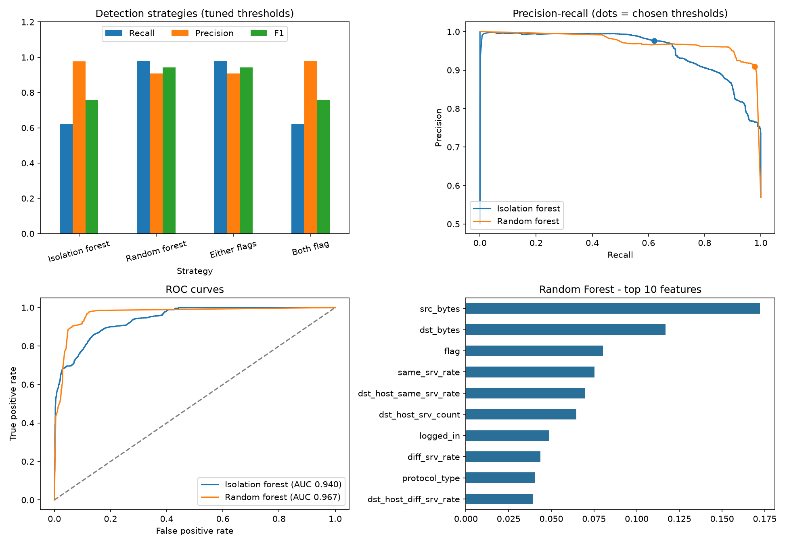
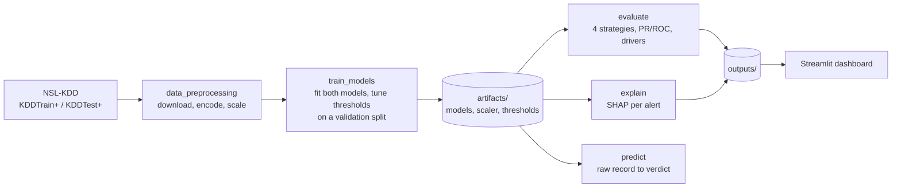

# Data Center Cyber-Physical Defense

[](https://github.com/Aaravnauti/datacenter-security-capstone/actions/workflows/ci.yml)


**AI anomaly detection for the IT/OT boundary of a data center, built alongside a VAPT attack
reconstruction.** An unsupervised Isolation Forest and a supervised Random Forest detect
intrusion behaviour that signature-based firewalls miss, and SHAP explains every alert.

Capstone project combining *Artificial Intelligence for Cyber Security* (ICS3120) and
*Vulnerability Assessment & Penetration Testing* (ICS3102).

## Why this matters

Data centers run on IT systems (servers, monitoring dashboards such as Cacti, IPMI/BMC
interfaces) and on physical controls (UPS power, HVAC cooling). An attacker who breaches an
exposed monitoring tool can pivot toward the facility network and manipulate telemetry, such
as spoofed UPS battery data or altered cooling setpoints, until a thermal shutdown occurs.
Known-signature tools often miss this behaviour. This project detects it from traffic
statistics and explains why each alert fired.

## Results

Trained on the official NSL-KDD training set (`KDDTrain+`) and evaluated on the separate
test set (`KDDTest+`), which contains attack types that never appear in training. Metrics are
for the malicious class (22,544 test connections: 12,833 malicious, 9,711 benign).

Alert thresholds are tuned automatically from precision-recall curves on a validation split
of the **training** data (the test set is never used for tuning). Isolation Forest alerts
when its anomaly score exceeds 0.532, Random Forest when P(malicious) reaches 0.015.

| Strategy | Recall | Precision | F1 | Accuracy | False alarms | Missed attacks |
|---|---|---|---|---|---|---|
| Isolation Forest alone | 0.62 | 0.98 | 0.76 | 0.78 | 195 | 4,864 |
| Random Forest alone | **0.98** | 0.91 | **0.94** | **0.93** | 1,262 | **271** |
| Either flags (OR) | **0.98** | 0.91 | 0.94 | 0.93 | 1,279 | 271 |
| Both flag (AND) | 0.62 | **0.98** | 0.76 | 0.78 | **178** | 4,864 |

For comparison, the same models at their untuned default thresholds (Isolation Forest at its
contamination cutoff, Random Forest at 0.50):

| Strategy | Recall | Precision | F1 | False alarms | Missed attacks |
|---|---|---|---|---|---|
| Isolation Forest alone | 0.95 | 0.79 | 0.86 | 3,174 | 681 |
| Random Forest alone | 0.62 | 0.97 | 0.75 | 278 | 4,931 |

**What this shows**

- **Threshold tuning is what fixed the Random Forest's low recall (0.62 to 0.98).** Class
  weighting (`class_weight: balanced_subsample`) is enabled, but it did not help on its own:
  NSL-KDD's training set is already about 53% benign and 47% attack, so there is little
  imbalance to correct. The misses come from novel attack types, which the default 0.50
  cutoff rejects.
- **The trade-off is real.** The tuned Random Forest raises 1,262 false alarms against 278
  before. Raise `thresholds.min_precision` to 0.99 and the "either flags" strategy gives
  recall 0.86 with 467 false alarms. Pick the point that matches how costly a false alarm is
  in your facility.
- **With tuned thresholds the Random Forest dominates here.** "Either flags" adds almost
  nothing beyond it. The Isolation Forest's value is that it needs no labeled attacks at all,
  so it is the fallback when labeled attack data is unavailable. At its default threshold it
  catches 95% of attacks with zero attack labels.
- **On attack types never seen in training, the models behave very differently.** 17 of the
  37 attack types in `KDDTest+` (3,750 attacks, 29% of the test attacks) do not appear in
  training. At default thresholds the Isolation Forest catches 99% of them and the Random
  Forest only 25%. The tuned Random Forest catches 94% (and 99.5% of known types), but the
  tuned Isolation Forest falls to 60%, because its strict threshold was chosen on validation
  data that contains no novel attacks. `python -m src.evaluate` prints the full table.
- **A threshold of 0.015 is aggressive.** It flags anything that even 1.5% of trees consider
  malicious. It transfers to `KDDTest+` because the novel attacks there resemble training
  families. It may not transfer to a genuinely new attack family, so re-tune on facility data.

An earlier version split a single file into train and test and reported a perfect 1.00.
That result was an artifact of the split, so this repository evaluates on the separate
official test file.



Confusion matrices for all four strategies are in `outputs/confusion_matrices.png`, and the
traffic features that most distinguish flagged connections are in `outputs/feature_drivers.csv`.

## Architecture



Production target (SIEM ingestion, SOAR playbooks, Zero Trust segmentation) is described in
[`docs/enterprise_architecture.md`](docs/enterprise_architecture.md).

## Threat model

Defensive reconstruction mapped to MITRE ATT&CK. Each stage names the signal the AI layer
watches for. Details in [`docs/kill_chain.md`](docs/kill_chain.md).

| Stage | Technique | Detection signal |
|---|---|---|
| 1. Initial access | Exploit public-facing application (T1190), e.g. a Cacti-class monitoring tool, CVE-2022-46169 | Spike in failed logins and request rate on the monitoring segment |
| 2. Credential harvest and lateral movement | Credential Access (TA0006), Lateral Movement (TA0008) | New internal connection pairs, connection-rate deviations |
| 3. Subsystem manipulation | Manipulation of Control (T0831, ATT&CK for ICS) | Telemetry outside the learned benign baseline |
| 4. Physical impact | Damage to Property (T0879, ATT&CK for ICS) | Alert should fire at stages 1 to 3, before this point |

Vulnerability findings with CVSS v3.1 vectors are in [`docs/cvss_findings.md`](docs/cvss_findings.md),
and the matching controls in [`docs/remediation_playbook.md`](docs/remediation_playbook.md).

## Quickstart

### Local

```bash
python -m venv .venv
```

```bash
# Windows PowerShell:  .venv\Scripts\Activate.ps1      macOS/Linux:  source .venv/bin/activate
pip install -r requirements.txt
```

```bash
python -m src.pipeline
```

This downloads NSL-KDD (cached in `data/raw/`), trains both models and tunes their
thresholds into `artifacts/`, and writes metrics, plots and the SHAP files to `outputs/`.
Run the stages separately with `python -m src.train_models`, `python -m src.evaluate` and
`python -m src.explain`.

Classify raw records with the saved models (two illustrative NSL-KDD-style connections):

```bash
python -m src.predict --demo
```

or from Python:

```python
from src.predict import predict_telemetry

result = predict_telemetry({"duration": 0, "protocol_type": "tcp", ...})[0]  # all 41 features
print(result["prediction"], result["top_drivers"])
```

`predict_telemetry` accepts a dict, a pandas Series or DataFrame, or a list of dicts, with
categorical fields as text (`"tcp"`). It returns the verdict, both model scores against their
thresholds, and the most unusual features for each record.

### Live alert replay

Stream recorded connections through the saved models, paced like live traffic. An alert is
raised, with the reasons, whenever the chosen strategy flags a connection:

```bash
python -m src.live_monitor --count 300 --attack-rate 0.10 --rate 15
```

```text
[03:17:36] ALERT #2   HIGH   conn 20   IF 0.625 / RF 1.000  why: flag=REJ, same_srv_rate=0.02, ...  [replay check: REAL ATTACK - neptune]
[03:17:36] ALERT #3   MEDIUM conn 21   IF 0.437 / RF 0.650  why: protocol_type=icmp, logged_in=0, ... [replay check: FALSE ALARM]
```

Alerts are written to `outputs/live_alerts.jsonl`, and the same stream is available as the
**Live monitor** tab of the dashboard. Severity is high when both models flag a connection and
medium when only one does. This is a replay of a labeled benchmark, not a packet capture; the
"replay check" is only possible because the replayed connections are labeled. A real deployment
would put a flow collector in front of the same scoring step.

**Expect many false alarms when attacks are rare.** The 0.91 precision reported below was
measured on a test set that is 57% attacks. In the replay, with the default "either flags"
strategy: at 10% attacks about 44% of alerts are real, and at 1% attacks only about 7% are
(283 alerts, 263 of them false). A small false-alarm rate applied to a large amount of benign
traffic outweighs a few real attacks. See the report for the full table.

```bash
streamlit run app.py
```

Opens the interactive dashboard at http://localhost:8501 (threshold sliders, SHAP plots,
kill chain, roadmap).

```bash
pip install -r requirements-dev.txt
pytest -q
ruff check .
```

### Docker

```bash
docker build -t datacenter-security-capstone .
```

```bash
docker run --rm datacenter-security-capstone
```

To keep the results on your machine, mount the output folder (on Linux add `--user $(id -u)`):

```bash
docker run --rm -v "$(pwd)/outputs:/app/outputs" datacenter-security-capstone
```

To run the dashboard from the container:

```bash
docker run --rm -p 8501:8501 datacenter-security-capstone streamlit run app.py --server.address 0.0.0.0
```

No network? Set `DCSEC_DATA_SOURCE=synthetic` to use the built-in synthetic data-center
telemetry generator (this is what the tests and CI use).

## Repository structure

```
.
├── app.py                          Streamlit dashboard
├── config/config.yaml              Data source, model parameters, paths
├── src/
│   ├── data_preprocessing.py       Download, encode (persisted category maps), scale, split
│   ├── train_models.py             Train both models, tune thresholds, save with joblib
│   ├── thresholds.py               PR-curve threshold tuning and the four detection strategies
│   ├── evaluate.py                 Strategy metrics, PR/ROC curves, confusion matrices
│   ├── feature_analysis.py         Feature importances and drivers of flagged traffic
│   ├── explain.py                  SHAP explanations per alert
│   ├── predict.py                  predict_telemetry(): raw record to verdict
│   ├── live_monitor.py             Live alert replay: stream connections, raise alerts
│   ├── pipeline.py                 Train, evaluate, explain in one command
│   ├── config.py                   Config and path helpers
│   └── generate_synthetic_data.py  Offline fallback telemetry generator
├── tests/                          pytest suite (no network required)
├── docs/                           Project report (docx, pdf), kill chain, CVSS, remediation, case study, enterprise architecture
├── outputs/                        Metrics and plots from the last run
├── Dockerfile
└── .github/workflows/ci.yml        Lint, tests, smoke run, Docker build
```

## Engineering notes

- **Honest evaluation:** separate official test file, malicious-class precision, recall and
  F1, ROC-AUC. Accuracy alone is misleading on imbalanced security data.
- **No leakage:** the scaler is fit on training data only, the Isolation Forest only sees
  benign training rows, and alert thresholds are tuned on a validation split of the training
  data, never on the test set.
- **Reproducible:** fixed random seeds, a single YAML config, pinned lower bounds.
- **Explainable:** SHAP values for both models, exported per alert in
  `outputs/alert_explanations.csv`.
- **Tested:** unit tests for preprocessing, training, evaluation and SHAP; CI runs them on
  Python 3.11 and 3.12, plus an end-to-end smoke run and a Docker build.

## Limitations

- NSL-KDD is a dated network-intrusion benchmark. It contains no UPS, HVAC or BMS telemetry,
  so the data-center story is a use case, not something measured here. Performance must be
  re-established on facility data before any real deployment.
- Both models are tree ensembles on per-connection features. They do not model time, so
  slow drift in a sensor value would need a sequence model (for example an LSTM autoencoder).
- CVSS scores in `docs/cvss_findings.md` are illustrative until measured in a lab.

## Ethics and scope

All offensive testing is performed only in an isolated lab that the author owns and is
authorized to test. This repository contains no exploit code. The VAPT material is
reconstruction, scoring and remediation guidance.
