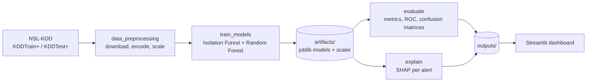

# Data Center Cyber-Physical Defense

[](https://github.com/Aaravnauti/datacenter-security-capstone/actions/workflows/ci.yml)


**AI anomaly detection for the IT/OT boundary of a data center, built alongside a VAPT attack
reconstruction.** An unsupervised Isolation Forest and a supervised Random Forest detect
intrusion behaviour that signature-based firewalls miss, and SHAP explains every alert.

Capstone project combining *Artificial Intelligence for Cyber Security* (ICS3120) and
*Vulnerability Assessment & Penetration Testing* (ICS3102).

## Why this matters

Data centers run on IT systems (servers, monitoring dashboards such as Cacti, IPMI/BMC
interfaces) and on physical controls (UPS power, HVAC cooling). An attacker who breaches an
exposed monitoring tool can pivot toward the facility network and manipulate telemetry, such
as spoofed UPS battery data or altered cooling setpoints, until a thermal shutdown occurs.
Known-signature tools often miss this behaviour. This project detects it from traffic
statistics and explains why each alert fired.

## Results

Trained on the official NSL-KDD training set (`KDDTrain+`) and evaluated on the separate
test set (`KDDTest+`), which contains attack types that never appear in training. Metrics are
for the malicious class (22,544 test connections: 12,833 malicious, 9,711 benign).

| Model | Role | Precision | Recall | F1 | ROC-AUC |
|---|---|---|---|---|---|
| Isolation Forest | Unsupervised, trained on benign traffic only | 0.79 | **0.95** | 0.86 | 0.94 |
| Random Forest | Supervised signature classifier | **0.97** | 0.62 | 0.76 | 0.96 |

**The two models fail in opposite ways, which is why the design uses both.**
The Isolation Forest catches 95% of attacks, including unseen types, but raises 3,174 false
alarms on benign traffic. The Random Forest raises only 274 false alarms but misses 38% of
novel attacks. In a data center, false alarms are costly (an automated reaction to a false
thermal alert can cause an outage), so the recommended design lets the anomaly detector
raise a candidate and uses the classifier, context and a human to confirm it.
See [`docs/enterprise_architecture.md`](docs/enterprise_architecture.md).

An earlier version split a single file into train and test and reported a perfect 1.00.
That result was an artifact of the split, so this repository evaluates on the separate
official test file.


## Architecture



Production target (SIEM ingestion, SOAR playbooks, Zero Trust segmentation) is described in
[`docs/enterprise_architecture.md`](docs/enterprise_architecture.md).

## Threat model

Defensive reconstruction mapped to MITRE ATT&CK. Each stage names the signal the AI layer
watches for. Details in [`docs/kill_chain.md`](docs/kill_chain.md).

| Stage | Technique | Detection signal |
|---|---|---|
| 1. Initial access | Exploit public-facing application (T1190), e.g. a Cacti-class monitoring tool, CVE-2022-46169 | Spike in failed logins and request rate on the monitoring segment |
| 2. Credential harvest and lateral movement | Credential Access (TA0006), Lateral Movement (TA0008) | New internal connection pairs, connection-rate deviations |
| 3. Subsystem manipulation | Manipulation of Control (T0831, ATT&CK for ICS) | Telemetry outside the learned benign baseline |
| 4. Physical impact | Damage to Property (T0879, ATT&CK for ICS) | Alert should fire at stages 1 to 3, before this point |

Vulnerability findings with CVSS v3.1 vectors are in [`docs/cvss_findings.md`](docs/cvss_findings.md),
and the matching controls in [`docs/remediation_playbook.md`](docs/remediation_playbook.md).

## Quickstart

### Local

```bash
python -m venv .venv
```

```bash
# Windows PowerShell:  .venv\Scripts\Activate.ps1      macOS/Linux:  source .venv/bin/activate
pip install -r requirements.txt
```

```bash
python -m src.pipeline
```

This downloads NSL-KDD (cached in `data/raw/`), trains both models into `artifacts/`,
and writes `metrics.json`, `results.png` and the SHAP files to `outputs/`.
Run the stages separately with `python -m src.train_models`, `python -m src.evaluate` and
`python -m src.explain`.

```bash
streamlit run app.py
```

Opens the interactive dashboard at http://localhost:8501 (threshold sliders, SHAP plots,
kill chain, roadmap).

```bash
pip install -r requirements-dev.txt
pytest -q
ruff check .
```

### Docker

```bash
docker build -t datacenter-security-capstone .
```

```bash
docker run --rm datacenter-security-capstone
```

To keep the results on your machine, mount the output folder (on Linux add `--user $(id -u)`):

```bash
docker run --rm -v "$(pwd)/outputs:/app/outputs" datacenter-security-capstone
```

To run the dashboard from the container:

```bash
docker run --rm -p 8501:8501 datacenter-security-capstone streamlit run app.py --server.address 0.0.0.0
```

No network? Set `DCSEC_DATA_SOURCE=synthetic` to use the built-in synthetic data-center
telemetry generator (this is what the tests and CI use).

## Repository structure

```
.
├── app.py                          Streamlit dashboard
├── config/config.yaml              Data source, model parameters, paths
├── src/
│   ├── data_preprocessing.py       Download, label-encode, scale, split
│   ├── train_models.py             Train both models, save with joblib
│   ├── evaluate.py                 Metrics, ROC, confusion matrices
│   ├── explain.py                  SHAP explanations per alert
│   ├── pipeline.py                 Train, evaluate, explain in one command
│   ├── config.py                   Config and path helpers
│   └── generate_synthetic_data.py  Offline fallback telemetry generator
├── tests/                          pytest suite (no network required)
├── docs/                           Kill chain, CVSS, remediation, case study, enterprise architecture
├── outputs/                        Metrics and plots from the last run
├── Dockerfile
└── .github/workflows/ci.yml        Lint, tests, smoke run, Docker build
```

## Engineering notes

- **Honest evaluation:** separate official test file, malicious-class precision, recall and
  F1, ROC-AUC. Accuracy alone is misleading on imbalanced security data.
- **No leakage:** the scaler is fit on training data only, and the Isolation Forest only sees
  benign training rows.
- **Reproducible:** fixed random seeds, a single YAML config, pinned lower bounds.
- **Explainable:** SHAP values for both models, exported per alert in
  `outputs/alert_explanations.csv`.
- **Tested:** unit tests for preprocessing, training, evaluation and SHAP; CI runs them on
  Python 3.11 and 3.12, plus an end-to-end smoke run and a Docker build.

## Limitations

- NSL-KDD is a dated network-intrusion benchmark. It contains no UPS, HVAC or BMS telemetry,
  so the data-center story is a use case, not something measured here. Performance must be
  re-established on facility data before any real deployment.
- Both models are tree ensembles on per-connection features. They do not model time, so
  slow drift in a sensor value would need a sequence model (for example an LSTM autoencoder).
- CVSS scores in `docs/cvss_findings.md` are illustrative until measured in a lab.

## Ethics and scope

All offensive testing is performed only in an isolated lab that the author owns and is
authorized to test. This repository contains no exploit code. The VAPT material is
reconstruction, scoring and remediation guidance.
